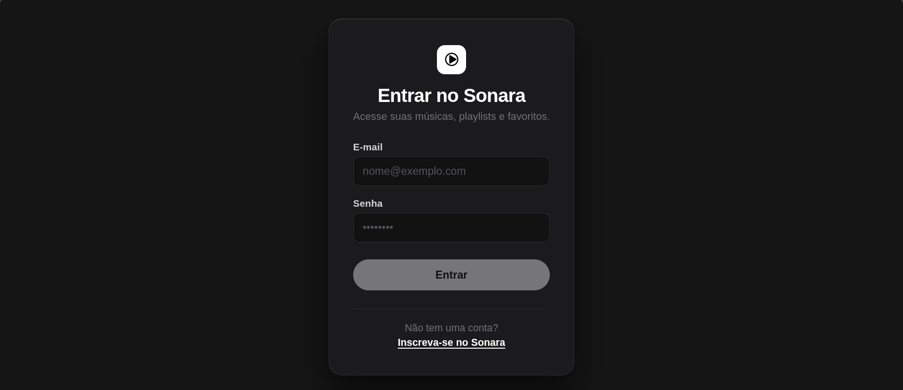
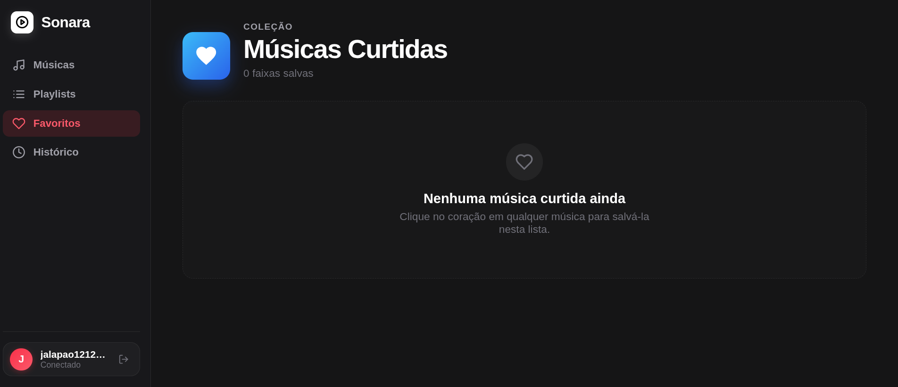

# Sonara 🎵

[](https://github.com/benjaexz/Sonara/actions/workflows/ci.yml)
[](https://openjdk.org/)
[](https://spring.io/projects/spring-boot)
[](https://angular.dev/)
[](https://www.postgresql.org/)
[](https://www.docker.com/)

O **Sonara** é uma plataforma completa de streaming e gestão musical, desenvolvida com arquitetura desacoplada: cliente web em **Angular**, API RESTful em **Java 21 / Spring Boot 3**, persistência relacional com **PostgreSQL**, esteira de **CI/CD via GitHub Actions**, orquestração em **Docker** e deploy automatizado na nuvem.

---

## 🚀 Demonstração ao vivo

- **Aplicação (SPA):** <https://sonara-amber.vercel.app>
- **API (Swagger / OpenAPI):** <https://sonara-backend-kh00.onrender.com/swagger-ui/index.html>

> 💡 **Para recrutadores / demonstração:** se preferir não criar uma conta, use as credenciais de teste:
>
> - **E-mail:** `demo@sonara.io`
> - **Senha:** `Sonara@123`

> ⚠️ **Aviso sobre o plano gratuito do Render:** o backend hiberna após períodos de inatividade. A primeira requisição pode levar cerca de 50 segundos para acordar a instância.

---

## 📸 Screenshots

| Login | Músicas Curtidas |
|---|---|
|  |  |

---

## 📑 Índice

- [Demonstração ao vivo](#-demonstração-ao-vivo)
- [Screenshots](#-screenshots)
- [Arquitetura da Solução](#️-arquitetura-da-solução)
- [Decisões de Engenharia](#️-decisões-de-engenharia)
- [Funcionalidades](#-funcionalidades)
- [Modelo de Domínio](#-modelo-de-domínio)
- [Stack Tecnológica](#️-stack-tecnológica)
- [Estrutura do Repositório](#-estrutura-do-repositório)
- [Documentação da API (Swagger UI)](#-documentação-da-api-swagger-ui)
- [Importação de Faixas (Jamendo)](#-importação-de-faixas-jamendo)
- [Testes Automatizados](#-testes-automatizados)
- [Pipeline de CI/CD](#-pipeline-de-cicd)
- [Variáveis de Ambiente](#️-variáveis-de-ambiente)
- [Como Executar o Projeto](#-como-executar-o-projeto)
- [Deploy](#-deploy)
- [Roadmap](#️-roadmap)
- [Créditos](#-créditos)
- [Autor](#-autor)
- [Licença](#-licença)

---

## 🏛️ Arquitetura da Solução

O projeto é um monorepo com dois módulos desacoplados:

- **Frontend (SPA):** interface reativa em Angular com TypeScript, consumindo a API REST autenticada via cabeçalho `Authorization: Bearer <token>`. Em produção, servida por Nginx.
- **Backend (API RESTful):** Spring Boot com Spring Security, sessões stateless via JWT, validação de dados e arquitetura em camadas (`Controller`, `Service`, `Repository`, `DTO`).
- **Banco de dados:** PostgreSQL com integridade referencial, gerenciado via Spring Data JPA / Hibernate, com mapeamentos N:N e 1:N (playlists, faixas, avaliações e favoritos).

```text
     Navegador / Cliente
             │
   HTTPS (Bearer JWT)
             ▼
┌─────────────────────────┐
│   Angular Frontend      │  (Vercel)
└────────────┬────────────┘
             │ REST / JSON
             ▼
┌─────────────────────────┐
│   Spring Boot 3 API     │  (Render)
│  Security + JWT Filter  │
└────────────┬────────────┘
             │ Spring Data JPA
             ▼
┌─────────────────────────┐
│   PostgreSQL            │  (Render)
└─────────────────────────┘
```

---

## ⚙️ Decisões de Engenharia

1. **Autenticação stateless com JWT + BCrypt:** senhas com hash `BCryptPasswordEncoder`; tokens JWT (JJWT) emitidos no login e validados por um `JwtAuthenticationFilter` (`OncePerRequestFilter`) que popula o `SecurityContext`. Sem sessão no servidor, o que facilita escalar a API.
2. **DTOs desacoplados das entidades JPA:** evitam `LazyInitializationException` e loops de serialização bidirecional no Jackson, e deixam o contrato da API independente do modelo de banco.
3. **Tratamento global de exceções:** `@RestControllerAdvice` centraliza as respostas de erro (400, 401, 403, 404, 409) em um formato padronizado.
4. **Interceptor e guard no Angular:** o `authInterceptor` injeta o token em cada requisição e o `authGuard` bloqueia rotas protegidas, redirecionando para `/login`. O estado de autenticação é reativo (`BehaviorSubject`).
5. **CORS configurável por ambiente:** as origens permitidas vêm da variável `CORS_ALLOWED_ORIGINS`, sem hardcode no código.
6. **Endpoint administrativo protegido por chave:** a importação de faixas exige o header `X-Admin-Key`, comparado com a variável de ambiente `ADMIN_IMPORT_KEY`.

---

## ✨ Funcionalidades

- **Autenticação e segurança:** cadastro e login de usuários com hash BCrypt e emissão de tokens JWT.
- **Catálogo de áudio:** exploração e reprodução de faixas, artistas e álbuns, com faixas Creative Commons importadas do Jamendo.
- **Gestão de playlists:** criação, edição, exclusão e reordenação de faixas, com validação de posse (*ownership*).
- **Favoritos:** marcação e gestão de faixas favoritas do usuário autenticado.
- **Avaliações:** pontuação de faixas de 1 a 5 estrelas (API pronta; interface visual no [roadmap](#️-roadmap)).
- **Histórico de reprodução:** registro das faixas ouvidas pelo usuário.
- **Importação automática de catálogo:** endpoint administrativo que popula o banco com faixas da API do Jamendo.
- **Tratamento centralizado de exceções:** respostas de erro padronizadas para 400, 401, 403, 404 e 409.

---

## 📦 Modelo de Domínio

- **Catálogo:** `Artist` ➔ `Album` ➔ `Track` ➔ `Genre`
- **Usuário:** `User`, com senha em hash e username único
- **Playlists:** `Playlist` ➔ `PlaylistTrack` (com posição indexada)
- **Engajamento:** `Favorite` (única por usuário/faixa), `ListeningHistory`, `TrackRating` (1 a 5) e `TrackComment`

---

## 🛠️ Stack Tecnológica

| Camada | Tecnologia | Detalhes |
| --- | --- | --- |
| **Frontend** | Angular 19 + TypeScript | SPA conteinerizada com Nginx |
| **Backend** | Java 21 & Spring Boot 3.5.14 | API RESTful, build via Maven Wrapper |
| **Segurança** | Spring Security + JJWT 0.12.6 | Controle de acesso e tokens JWT stateless |
| **Banco de dados** | PostgreSQL 16 | Armazenamento relacional e integridade referencial |
| **ORM** | Spring Data JPA / Hibernate | Persistência desacoplada |
| **Documentação** | SpringDoc OpenAPI 2.8.5 | Swagger UI interativo |
| **Testes** | JUnit 5 + Mockito + MockMvc | 33 testes automatizados (unitários, integração web e segurança) |
| **DevOps** | Docker / Docker Compose | Multi-stage builds (Alpine), rede interna e healthcheck |
| **CI/CD** | GitHub Actions | Build, testes com service container e deploy contínuo |
| **Hospedagem** | Vercel (frontend) & Render (backend) | Deploy automatizado via webhook |
| **Fonte de áudio** | Jamendo API | Faixas sob licenças Creative Commons |

---

## 📁 Estrutura do Repositório

```text
Sonara/
├── backend/                       # API REST em Spring Boot
│   ├── src/
│   │   ├── main/java/io/sonara/
│   │   │   ├── config/            # Segurança, CORS e OpenAPI/Swagger
│   │   │   ├── controller/        # Controladores REST
│   │   │   ├── dto/               # Data Transfer Objects
│   │   │   ├── exception/         # Tratamento global de exceções
│   │   │   ├── model/             # Entidades JPA
│   │   │   ├── repository/        # Repositórios Spring Data JPA
│   │   │   ├── security/          # Filtro JWT e UserDetailsService
│   │   │   └── service/           # Regras de negócio e validações
│   │   └── test/                  # 33 testes automatizados
│   ├── Dockerfile                 # Multi-stage (JDK 21 compile -> JRE 21 runtime)
│   └── pom.xml
│
├── frontend/                      # SPA Angular
│   ├── src/                       # Componentes, serviços, rotas e estilos
│   ├── Dockerfile                 # Multi-stage (Node 20 compile -> Nginx runtime)
│   ├── nginx.conf                 # Roteamento SPA e servidor web
│   ├── package.json
│   └── angular.json
│
├── .github/workflows/
│   └── ci.yml                     # Pipeline de CI/CD
├── Screenshots/                   # Imagens usadas neste README
├── docker-compose.yml             # Orquestração local (DB, API, Front)
├── .env.example                   # Modelo de variáveis de ambiente
└── README.md
```

---

## 📖 Documentação da API (Swagger UI)

- **Local:** <http://localhost:8080/swagger-ui/index.html>
- **Produção:** <https://sonara-backend-kh00.onrender.com/swagger-ui/index.html>
- **OpenAPI (JSON):** <http://localhost:8080/v3/api-docs>

**Como autenticar no Swagger:**

1. Execute `POST /auth/login` para obter o token JWT.
2. Clique em **Authorize**, no canto superior direito.
3. Cole o token para liberar os endpoints protegidos.

---

## 🎧 Importação de Faixas (Jamendo)

O catálogo é populado com faixas Creative Commons da [API do Jamendo](https://developer.jamendo.com/). A importação é feita por um endpoint administrativo, protegido por chave:

```bash
curl -X POST "https://sonara-backend-kh00.onrender.com/admin/import/jamendo" \
  -H "X-Admin-Key: <sua ADMIN_IMPORT_KEY>"
```

- O header `X-Admin-Key` deve corresponder à variável de ambiente `ADMIN_IMPORT_KEY` configurada no backend. Sem a chave correta, a requisição é rejeitada.
- Cada `Track` guarda o `audioUrl` e a capa (`coverUrl`) vindos do Jamendo, usados pelo player.
- A variável `JAMENDO_CLIENT_ID` precisa estar configurada para o backend consultar a API do Jamendo.

---

## 🧪 Testes Automatizados

33 testes automatizados garantem a estabilidade da aplicação:

- **Serviço (unitários com Mockito):** regras de negócio, permissões de playlist e regras de avaliação.
- **Web (integração com MockMvc):** códigos HTTP (200, 201, 204, 400, 401, 403, 404, 409), serialização JSON e tratamento de exceções.
- **Segurança:** filtros JWT bloqueando acesso anônimo a rotas protegidas e liberando as públicas.

Para rodar localmente:

```bash
cd backend
./mvnw clean verify
```

---

## 🔄 Pipeline de CI/CD

A esteira fica em `.github/workflows/ci.yml`.

**Integração contínua (CI):**

1. Provisiona uma VM Ubuntu limpa.
2. Sobe um service container com PostgreSQL 16 e aguarda o healthcheck (`pg_isready`).
3. Configura o Java 21 (Eclipse Temurin) com cache de dependências Maven.
4. Compila o código e executa os 33 testes.

**Entrega contínua (CD):**

1. Se todos os testes passarem na branch `main`, o job de deploy é acionado.
2. Chama o Deploy Hook do Render via webhook secreto (`RENDER_DEPLOY_HOOK`), atualizando a API em produção sem intervenção manual.

---

## ⚙️ Variáveis de Ambiente

Crie um arquivo `.env` na raiz do projeto (use o `.env.example` como modelo):

```bash
# Banco de dados
POSTGRES_DB=sonaradb
POSTGRES_USER=sonara_user
POSTGRES_PASSWORD=sua_senha_segura
PORT_DB=5432

# Frontend
PORT_FRONTEND=8080

# Backend / JWT
SPRING_DATASOURCE_URL=jdbc:postgresql://localhost:5432/sonaradb
SPRING_DATASOURCE_USERNAME=sonara_user
SPRING_DATASOURCE_PASSWORD=sua_senha_segura
JWT_SECRET=chave_secreta_jwt_longa_e_aleatoria_com_mais_de_256_bits
JWT_EXPIRATION=86400000
CORS_ALLOWED_ORIGINS=http://localhost:4200,http://localhost:8080,https://sonara-amber.vercel.app

# Importação de faixas (Jamendo)
JAMENDO_CLIENT_ID=seu_client_id_do_jamendo
ADMIN_IMPORT_KEY=chave_longa_e_aleatoria_para_o_endpoint_admin
```

> 🔒 Nunca versione o `.env`. No Render, essas variáveis ficam configuradas no painel do serviço.

---

## 🚀 Como Executar o Projeto

### 1. Docker Compose (recomendado)

Sobe PostgreSQL, API Spring Boot e Angular com Nginx a partir da raiz:

```bash
# Build das imagens e início dos contêineres em segundo plano
docker compose up -d --build

# Logs de todos os serviços
docker compose logs -f

# Logs apenas do backend
docker compose logs -f backend

# Parar tudo
docker compose down
```

A aplicação web fica em <http://localhost:8080>.

### 2. Execução manual (desenvolvimento local)

**Backend** (Java 21 e PostgreSQL em execução):

```bash
cd backend
./mvnw clean spring-boot:run
```

A API fica em <http://localhost:8080>.

**Frontend** (Node.js 20+):

```bash
cd frontend
npm install
npm start
```

A interface fica em <http://localhost:4200>.

---

## 🌐 Deploy

- **Frontend:** Vercel, em [sonara-amber.vercel.app](https://sonara-amber.vercel.app)
- **Backend:** contêiner no Render com PostgreSQL gerenciado, em [sonara-backend-kh00.onrender.com](https://sonara-backend-kh00.onrender.com)
- **Monitoramento:** monitor de uptime externo apontando para a API

---

## 🗺️ Roadmap

- [x] Autenticação stateless com JWT + BCrypt
- [x] CRUD de catálogo (artistas, álbuns e faixas)
- [x] Interceptor Angular e `authGuard`
- [x] Favoritos e playlists
- [x] Testes automatizados (33)
- [x] CI/CD com GitHub Actions e deploy automático
- [x] Importação de faixas Creative Commons via Jamendo
- [ ] Interface visual para avaliações (1 a 5 estrelas) e comentários
- [ ] Fila de reprodução avançada (shuffle / repeat)
- [ ] Crédito ao artista na tela do player
- [ ] Retry e tolerância a falhas no importador do Jamendo
- [ ] Importar mais faixas para o catálogo

---

## 🙏 Créditos

As faixas do catálogo vêm do [Jamendo](https://www.jamendo.com/) e pertencem aos respectivos artistas, disponibilizadas sob licenças Creative Commons. Cada faixa mantém a licença definida pelo artista na plataforma de origem.

---

## 👤 Autor

Desenvolvido por **Jacó Lima**.

- **GitHub:** [@benjaexz](https://github.com/benjaexz)

---

## 📄 Licença

Este projeto está sob a licença MIT.
